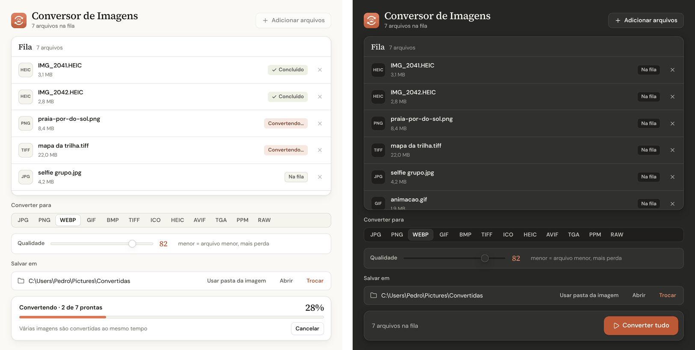

# Conversor de Imagens

Aplicativo de janela para Windows e Mac que converte várias imagens de uma vez entre **JPG, PNG, WEBP, GIF, BMP, TIFF, ICO,
HEIC, AVIF, TGA, PPM** e **RAW** (pixels puros, sem cabeçalho, usado em fluxos de glitch art). É o irmão do
[Conversor de Vídeos](https://github.com/vonhauke/conversor-de-videos), com o mesmo visual. A conversão é feita pela
[Pillow](https://python-pillow.org/) (e pela [pillow-heif](https://github.com/bigcat88/pillow_heif) para HEIC).

- Visual no estilo dos apps do Claude (design system **Argila**, em `ui/ds/`): fundo creme, laranja terracota,
  títulos em serifa e **tema escuro automático** que segue o Windows/Mac
- Conversão em lote: arraste imagens **ou pastas inteiras** (com subpastas) e clique em **Converter tudo**
- Controle de **qualidade** para os formatos com perda (JPG, WEBP, HEIC e AVIF)
- Mantém **animações** ao converter entre GIF, WEBP, PNG (APNG), AVIF e TIFF de várias páginas
- Fotos de celular deitadas são endireitadas automaticamente (orientação EXIF)
- Mantém os dados EXIF e o perfil de cor quando o formato de destino aceita
- **Rápido em lotes grandes:** converte várias imagens ao mesmo tempo, usando os vários núcleos do processador (sem mudar nada na qualidade)
- **Converte só o que falta:** clicar de novo em **Converter** só processa os arquivos novos ou que deram erro. Trocar o formato, a qualidade ou a pasta libera tudo para converter de novo
- **Lembra suas escolhas:** formato, qualidade, pasta de destino e opções de `.raw` voltam como estavam da última vez
- Em caso de erro, o botão **ver detalhes** mostra o motivo
- Os arquivos convertidos são salvos como `nome_convertido.formato`, sem sobrescrever os originais nem conversões anteriores



## Baixar e usar (Windows)

1. Abra a página de [**Releases**](https://github.com/vonhauke/conversor-de-imagens/releases/latest) e baixe o arquivo **Conversor de Imagens.exe**.
2. Dê dois cliques nele. Não precisa instalar nada.

> Na primeira vez, o Windows pode mostrar um aviso azul (SmartScreen), porque o programa não é assinado.
> Clique em **Mais informações → Executar assim mesmo**.

## Rodar pelo código-fonte

Precisa de Windows ou Mac e Python 3.10+ (no Linux, também o WebKit: `sudo apt install python3-gi gir1.2-webkit2-4.1`).

```
pip install pywebview pillow pillow-heif
python main.py
```

## Como usar

1. **Arraste imagens ou pastas** do Explorer para a janela, ou clique em **+ Adicionar arquivos** (ou na área pontilhada) e escolha-as.
2. Escolha o formato em **Converter para** e, se for JPG, WEBP, HEIC ou AVIF, a **qualidade** (padrão 90).
3. Se quiser, troque a pasta em **Salvar em** (padrão: a pasta da primeira imagem adicionada). A pasta escolhida
   fica guardada para as próximas vezes; **Usar pasta da imagem** volta ao padrão.
4. Clique em **Converter tudo**.

As escolhas ficam em `%APPDATA%\Conversor de Imagens\config.json`.

## Velocidade

O app converte até 8 imagens ao mesmo tempo (uma por núcleo do processador, deixando um livre). HEIC e AVIF são
exceção: os codificadores desses formatos já usam quase todos os núcleos numa imagem só, então o app converte só 2
por vez, para não gastar memória à toa. Em testes com fotos de 6 MP, JPG, PNG e WEBP ficaram cerca de 5 vezes mais rápidos.

## Como cada formato é gravado

| Formato | Observações |
|---------|-------------|
| JPG | Não tem transparência: as partes transparentes viram fundo branco |
| PNG | Sem perda; mantém transparência e imagens de 16 bits |
| WEBP | Com perda (qualidade ajustável); mantém transparência e animação |
| GIF | Até 256 cores; transparência só total (sem meio-termo) |
| BMP | Sem compressão |
| TIFF | Compressão LZW (sem perda); mantém várias páginas |
| ICO | Ícone quadrado com 7 tamanhos (16 a 256 px); imagens não quadradas ganham bordas transparentes |
| HEIC | Formato das fotos do iPhone, qualidade ajustável |
| AVIF | Compressão ainda melhor que o WEBP, qualidade ajustável |
| TGA | Sem compressão, usado em jogos e texturas |
| PPM | Formato bem simples (`.ppm` colorido, ou `.pgm` cinza na entrada) |
| RAW | Só os pixels, no formato escolhido (`rgb24`, `bgr24`, `rgba`, `bgra` ou `gray`) |

Na entrada também são aceitos `.jpeg`, `.jfif`, `.apng`, `.dib`, `.tif`, `.heif`, `.pgm`, `.pbm` e `.pnm`.

## Arquivos .raw (glitch art)

Um `.raw` não tem cabeçalho: são só os bytes dos pixels, um atrás do outro. Isso permite abri-lo num editor de áudio
(como o Audacity, em *Importar → Dados brutos*) ou num editor hexadecimal, aplicar efeitos e depois transformá-lo de volta em imagem.

- **Como saída:** escolha `RAW` e o formato de pixel. O app coloca as dimensões e o formato no nome do arquivo
  (ex.: `foto_convertido_1920x1080_rgb24.raw`).
- **Como entrada:** se o nome tiver esse padrão, o app lê o arquivo sozinho. Se não tiver, aparece o painel
  *Parâmetros dos arquivos .raw* para informar largura, altura e formato de pixel (valem para todos os `.raw` sem o padrão no nome).
- Se o arquivo mudou de tamanho depois da edição, o app completa com preto o que faltar ou ignora o que sobrar, em vez de dar erro.

## Testes

```
python -m unittest discover -s tests -v
```

`tests/test_image_utils.py` converte cada tipo de entrada para cada formato de saída e cobre os casos delicados
(fotos de celular, 16 bits, perfis de cor, animações, `.raw`). `tests/test_app.py` roda lotes
completos na fila, sem abrir janela (só o que falta, pastas, conversão em paralelo, cancelar, escolhas lembradas).
`.github/teste_e2e.py` abre a janela real e usa o app como uma pessoa (precisa de tela).

## Gerar o .exe (Windows)

```
pip install pyinstaller pywebview pillow pillow-heif
python build_exe.py
```

O executável sai em `dist/`, em um único arquivo.

## Gerar o .app (Mac)

Só funciona rodando no próprio Mac (o PyInstaller não faz build cruzado).

```
brew install python
cd mac
pip3 install pyinstaller pywebview pillow pillow-heif
python3 build_mac.py
```

O app sai em `mac/dist/Conversor de Imagens.app`, copiado também para a Área de
Trabalho. Sem build, dá pra rodar direto o código-fonte:

```
brew install python
pip3 install pywebview pillow pillow-heif
python3 main.py
```

## Builds automáticos (GitHub Actions)

A cada envio para a `master`, a automação `.github/workflows/gerar-exe.yml` roda os testes e o teste de ponta a
ponta na janela real, num Windows e num Mac da nuvem do GitHub, e gera o `.exe` (Windows) e o `.app` (Mac Apple
Silicon e Mac Intel). Para baixar, abra a aba **Actions**, entre na execução mais recente e role até **Artifacts**.
No Mac, na primeira vez, clique no app com o botão direito → **Abrir** (ele não é assinado com certificado da Apple).

## Design

A tela é feita em HTML/CSS e mostrada numa janela nativa pelo [pywebview](https://pywebview.flowrl.com/)
(Edge WebView2 no Windows, que já vem no Windows 11 e na maioria dos Windows 10; WebKit no Mac).
O design system **Argila** (`ui/ds/` e `argila.py`) é o mesmo do SnapYou, do Conversor de Vídeos e do
my chaotic room: fontes Source Serif 4 e DM Sans (licença OFL), ícones [Lucide](https://lucide.dev)
(licença ISC). Veja `ui/ds/README.md`.

## Estrutura

| Arquivo | Função |
|---------|--------|
| `main.py` | Fila, escolhas e lote de conversão (classe `App`), e a ponte com a interface |
| `argila.py` | Parte Python do design system (janela, tema escuro, eventos para a interface), igual em todos os apps |
| `ui/` | A interface (`index.html`, `app.css`, `app.js`) e o design system Argila em `ui/ds/` |
| `image_utils.py` | Abre, ajusta o modo de cor e grava cada formato (inclusive `.raw`) |
| `build_exe.py` | Gera o `.exe` (Windows) |
| `mac/build_mac.py` | Gera o `.app` (Mac) |
| `tests/` | Testes automáticos |
| `.github/teste_e2e.py` | Teste de ponta a ponta na janela real |
| `docs/capturas/` | Capturas de tela usadas neste README |
| `icone_conversor.png` / `.ico` / `.icns` | Ícone do app |
